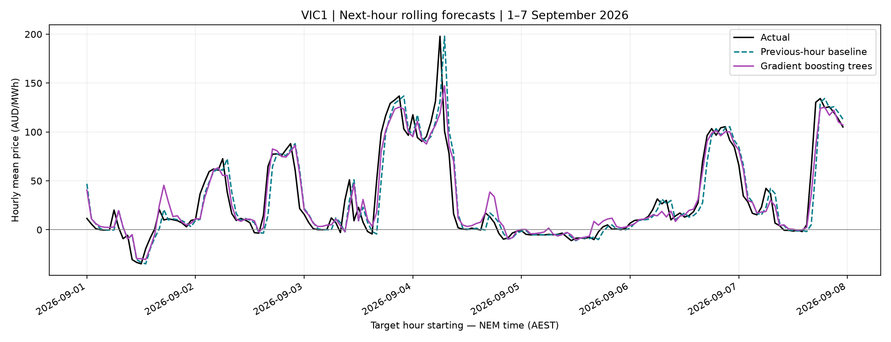
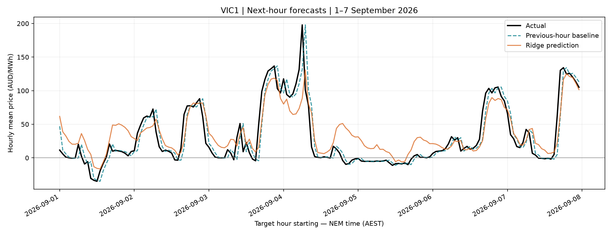

# NEM Pulse — Electricity Price Analytics & Procurement Risk

An evolving portfolio project for electricity retailers, using Australian NEM data to explore wholesale price exposure and next-hour forecasting.

[Open the bilingual dashboard](https://yangyinggit123.github.io/nem-pulse-energy-analytics/prototype/)

## Current progress

- **V0.2 complete:** October CSV validation, descriptive statistics, daily and intraday charts.
- **V0.3 SQL foundation complete:** 12 months of TAS1/VIC1 data, SQLite import, monthly and hourly risk summaries, interactive month and region filters, English/Chinese display and chart value tooltips.
- **V0.4 in progress:** VIC1 next-hour price forecasting with persistence baselines, Ridge and gradient boosting trees.
- **Planned:** Power BI, prediction intervals, retailer load and hedge scenarios, procurement-risk alerts and automated reports.

The public dashboard displays historical analysis. Forecast experiments are currently offline and are **not** integrated into the dashboard. No live feed, production forecasting service or real customer data is connected.

## Data and database

Coverage: **November 2025–October 2026**, TAS1 and VIC1. There are **210,240 five-minute records**, 105,120 per region. The 24 files were downloaded from [AEMO](https://aemo.com.au/energy-systems/electricity/national-electricity-market-nem/data-nem/aggregated-data). Download URLs and file hashes are in `data/download_manifest.csv`; checks are in `data/quality_report.json`.

Raw inputs are retained locally. Use `scripts/download_data.py` to obtain all 24 official files; this repository also retains the original October inputs. Official data can be revised: the downloader stops on hash differences instead of silently accepting a changed version. AEMO data remains subject to its applicable terms; this repository does not grant a separate data licence.

Database structure:

| Table | Grain | Rows |
|---|---|---:|
| `price_demand` | Region + five-minute interval ending | 210,240 |
| `monthly_summary` | Region + month | 24 |
| `hourly_risk_summary` | Region + hour of day across the year | 48 |

The two summary tables are snapshots derived from the detail table, not foreign-key-linked dimensions. Regenerate summaries after changing inputs. `sql/monthly_hourly_risk_summary.sql` supplies month-specific hourly dashboard data.

Timestamps follow NEM AEST (UTC+10), without daylight saving. Subtract five minutes from interval endings before assigning a month, day or hour. Prices are AUD/MWh; demand is MW. Negative prices and spikes are retained. A high-price interval means RRP **greater than 300 AUD/MWh**, an illustrative threshold rather than an official risk standard.

## Forecast experiments

Target: **next-hour average VIC1 wholesale price**, using the latest completed hourly observations. Training covers November 2025–August 2026 (7,272 usable hours after lag construction); validation covers September 2026 (720 hours). October is reserved for final testing and has not been evaluated for model selection. Historical October descriptive analysis does not form part of the forecast evaluation.

| Method | September validation MAE (AUD/MWh) |
|---|---:|
| Previous-hour persistence | 11.36 |
| Previous-day same-hour persistence | 40.58 |
| Ridge regression | 17.33 |
| Histogram gradient boosting trees | 9.88 |

The nonlinear model reduced validation MAE by **12.98%** relative to previous-hour persistence. This is a reduction in error, not an accuracy percentage or a demonstrated cost saving. It is one month's validation result, not proof of future or cross-season performance. No systematic parameter search has been performed.

All trained models use the same lagged price/demand and calendar features. No future actual demand is supplied. These are rolling one-hour forecasts with observed past hours becoming available over time, not a single month-ahead forecast. The experiment assumes each completed hour's observations are available at the prediction time; operational publication delays and data revisions are not yet simulated. Forecast error is assessed on hourly average prices and can conceal five-minute price spikes.





## Reproduce locally

Python 3.10 or later. On macOS/Linux, run from the repository root:

```bash
python3 -m venv .venv
source .venv/bin/activate
python -m pip install -r requirements.txt
python scripts/download_data.py
python scripts/create_database.py
python scripts/import_data.py
sqlite3 data/nem_pulse.db < sql/create_summary_tables.sql
python scripts/prepare_hourly.py
python scripts/baseline_forecast.py
python scripts/train_price_model.py
python scripts/train_nonlinear_model.py
python scripts/plot_forecast.py
```

`create_summary_tables.sql` creates the two materialized summary tables once; do not rerun against existing tables without reviewing how they will be refreshed. Input validation stops if the import file count or final record count is unexpected. The import script updates existing region/time keys, so repeated input imports do not duplicate rows. It does not automatically remove stale source records.

Saved SQL queries can be rerun independently:

```bash
sqlite3 -header -csv data/nem_pulse.db < sql/monthly_summary.sql > data/processed/annual_monthly_summary.csv
sqlite3 -header -csv data/nem_pulse.db < sql/hourly_risk_summary.sql > data/processed/annual_hourly_risk_summary.csv
sqlite3 -header -csv data/nem_pulse.db < sql/monthly_hourly_risk_summary.sql > data/processed/monthly_hourly_risk_summary.csv
```

Forecast output CSVs are in `data/processed/`. Database binaries, virtual environments and backups are intentionally excluded. The original `scripts/process_data.py` remains an October-only workflow; it is separate from the annual SQL summaries.

## Interpretation limits

Regional demand is not a retailer's customer portfolio load. Earlier procurement examples assumed a constant **10 MW**, fully spot-exposed portfolio; they are simulations, not real retailer costs or losses. Actual procurement analysis needs customer interval loads, contract and hedge terms, losses and other applicable charges. Observed correlations and seasonal patterns do not establish causes. Risk alerts and procurement decisions require more validation than aggregate MAE alone.
