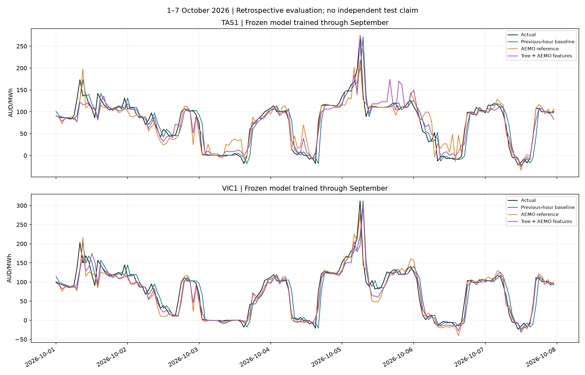

# NEM Pulse — Electricity Price Analytics & Procurement Risk

An evolving portfolio project for energy retailers, using Australian National Electricity Market (NEM) data to explore wholesale electricity prices, next-hour forecasts and procurement exposure.

[Historical dashboard](https://yangyinggit123.github.io/nem-pulse-energy-analytics/prototype/) · [Forecast experiments](https://yangyinggit123.github.io/nem-pulse-energy-analytics/prototype/forecast.html?v=aemo3)

Both pages support English and Chinese. The site presents historical observations and saved backtest results. It is not a live forecasting service, and no real customer portfolio or trading system is connected.

## Progress and roadmap

| Stage | Status | Scope |
|---|---|---|
| V0.2 — Historical analysis | Completed | CSV validation, descriptive statistics, daily and intraday charts |
| V0.3 — SQL and visualisation | SQL and web dashboard completed; Power BI pending | Twelve months of TAS1/VIC1 data, SQLite, monthly/hourly summaries and interactive filters |
| V0.4 — Forecasting | In development | Persistence baselines, Ridge, gradient boosting, an initial prediction-interval experiment, full-year AEMO predispatch features and expanding-history backtests |
| V0.5 — Procurement-risk alerts | Planned | Simulated retailer customer loads, unhedged exposure, high-price alerts and cost scenarios |
| V1.0 — Automated reporting | Planned | Data refresh, quality checks, charts and market reports |

## Historical data

Coverage: **November 2025–October 2026**, Tasmania (TAS1) and Victoria (VIC1): **210,240 five-minute records**, 105,120 per region.

The 24 monthly files were downloaded from [AEMO aggregated data](https://www.aemo.com.au/energy-systems/electricity/national-electricity-market-nem/data-nem/aggregated-data). Download URLs and hashes are recorded in `data/download_manifest.csv`; checks are in `data/quality_report.json`.

- Prices: AUD/MWh; regional demand: MW.
- Time: NEM AEST (UTC+10), without daylight saving.
- Five-minute timestamps mark interval endings. Subtract five minutes before assigning the interval to its month, day or hour.
- Negative prices and spikes are retained.
- RRP > 300 AUD/MWh is an illustrative high-price threshold, not an official risk standard.
- Regional demand is not a retailer's customer portfolio load.

Official data can be revised. The historical downloader checks hashes rather than silently accepting changed files. AEMO data remains subject to its applicable terms; this repository does not grant a separate data licence.

## Local database and public website

The SQLite database is stored locally at `data/nem_pulse.db`. The website reads published CSV results and images; it does not connect to the local database.

| Table | Grain | Rows in the current local dataset |
|---|---|---:|
| `price_demand` | Region + five-minute interval ending | 210,240 |
| `monthly_summary` | Region + month | 24 |
| `hourly_risk_summary` | Region + hour of day across the year | 48 |
| `predispatch_region_forecast` | Region + forecast vintage + target interval | Multiple versions retained |
| `predispatch_hourly_features` | Region + hourly forecast origin, November 2025–October 2026 | 17,520 |
| `predispatch_hourly_model_input` (view) | Report age ≤60 minutes; previous-hour observations present | 17,514 |

Summary tables are derived snapshots, not foreign-key-linked dimensions. Refresh them when inputs change. The database, virtual environment and large raw forecast archives are kept locally. Publishing a database file to GitHub would provide a download, not an online database service.

## Full-year AEMO predispatch features

Coverage now matches the historical dataset: **1 November 2025–31 October 2026 (365 days)**, with **8,760 hourly origins per region** and **17,520 hourly feature rows**. A total of 35,040 selected half-hour rows was extracted from 53 official weekly archives, including the lead-in report.

Inputs include predispatch price, regional demand, available generation/load, net interchange, and semi-scheduled wind/solar forecasts. Source: [AEMO predispatch reports](https://www.aemo.com.au/energy-systems/electricity/national-electricity-market-nem/data-nem/market-management-system-mms-data/pre-dispatch).

For each origin, select the latest report generated no later than that origin and covering the next two half-hour periods. Average their prices to construct an hourly reference. This is our aggregation, not a separately published AEMO hourly forecast.

Quality checks preserve all original records. Both regions' first hourly row lacks previous-hour observations. At 19:00 and 20:00 AEST on 10 March 2026, the latest available archived report was approximately 117 and 177 minutes old. The default model-input view excludes these four regional rows and the two first-hour rows; 60 minutes is a project threshold, not an AEMO standard. Model lag-24 construction additionally excludes the initial 24 hours per region.

**Availability limitation:** report generation time is a proxy for publication availability, not a verified receipt timestamp. Completed-hour actual observations are assumed available at each origin. Actual target prices are labels only, never predictors.

[Annual quality checks](reports/predispatch_year_quality.json) · [Archive manifest and SHA-256 hashes](data/predispatch_year_download_manifest.json)

## Latest forecasts: expanding historical training

The forecasting page now supports **region, evaluation month (August/September/October), chart date range, language and point-value tooltips**.

Models are refitted once before each evaluation month, using only earlier eligible hours from November 2025 onward, then held fixed within the month. Both trees use identical training targets and the previously fixed parameters. No new parameter search was performed.

The entire twelve months are **not** used to train a model and then score that same year. The October model trains through September; no production model has been fitted through October.

| Region | Evaluation month | Training hours | Baseline MAE | AEMO MAE | History tree MAE | Tree + AEMO MAE |
|---|---|---:|---:|---:|---:|---:|
| TAS1 | 2026-08 | 6,526 | 11.12 | **10.33** | 12.81 | 11.62 |
| TAS1 | 2026-09 | 7,270 | **11.75** | 12.65 | 12.86 | 13.31 |
| TAS1 | 2026-10 | 7,990 | **11.77** | 15.00 | 14.66 | 13.46 |
| VIC1 | 2026-08 | 6,526 | 12.12 | 10.06 | 11.04 | **9.57** |
| VIC1 | 2026-09 | 7,270 | 11.36 | 9.82 | 9.88 | **8.17** |
| VIC1 | 2026-10 | 7,990 | 13.88 | 13.51 | 13.69 | **11.16** |

MAE is in AUD/MWh; lower is better. Evaluation counts are 744 hours in August, 720 in September and 744 in October, per region. More history and features did not improve every region or month. The added-feature tree improved VIC1 results, while TAS1 persistence remained better in September and October.

**This is retrospective development evaluation, not a fresh independent test.** These periods have already been examined. No future-accuracy or procurement-savings claim is made.

Only one evaluation hour had actual hourly mean price above 300 AUD/MWh (VIC1, October). Its absolute errors were approximately 116.55 for the augmented tree, 91.27 for persistence and 34.26 for the AEMO reference. A better overall MAE does not establish better high-price risk detection, and hourly averaging can conceal five-minute spikes. Earlier prediction intervals have not been recalibrated for these refitted models.



[Predictions](data/processed/year_forecast_predictions.csv) · [Full metrics](data/processed/year_forecast_metrics.csv) · [Protocol](reports/year_forecast_protocol.json) · [Report](reports/year_forecast_report.md) · [Training script](scripts/train_year_forecasts.py)

### Earlier experiments

The earlier VIC1 experiment trained on November 2025–August 2026 (7,272 usable hours) and evaluated September (720 hours):

| Method | September MAE (AUD/MWh) |
|---|---:|
| Previous-hour persistence | 11.36 |
| Previous-day same-hour persistence | 40.58 |
| Ridge | 17.33 |
| Gradient boosting | 9.88 |

The latest history-only tree was retrained on August alone to match the shorter predispatch dataset. Its result is not the same model as the earlier 9.88 result.

A separate October evaluation produced MAE of approximately 13.88 for persistence and 13.65 for the longer-history tree. An initial fixed-width prediction-interval experiment was also completed locally. Its interval results are separate from the latest point forecasts and have not been recalibrated for the latest models.

## Repository structure

```text
data/
  raw/                    # Original October inputs; additional inputs downloaded locally
  processed/              # Historical summaries and saved forecast results
  download_manifest.csv
  quality_report.json
prototype/
  index.html              # Historical dashboard
  forecast.html           # Forecast experiments
  forecast.js
  forecast-expanded.js    # Latest bilingual comparison
scripts/                  # Data processing, database import and model experiments
sql/                      # Summary queries
reports/
  figures/
  augmented_forecast_protocol.json
README.md
requirements.txt
```

## Run the historical workflow locally

Use Python 3.10 or later. From the repository root on macOS/Linux:

```bash
python3 -m venv .venv
source .venv/bin/activate
python -m pip install -r requirements.txt
python scripts/download_data.py
python scripts/create_database.py
python scripts/import_data.py
sqlite3 data/nem_pulse.db < sql/create_summary_tables.sql
python scripts/prepare_hourly.py
python scripts/baseline_forecast.py
python scripts/train_price_model.py
python scripts/train_nonlinear_model.py
python scripts/plot_forecast.py
```

The summary-table creation script is intended for initial setup; review the refresh process before rerunning it against existing tables. Repeated raw imports update region/time keys instead of duplicating rows, but do not automatically remove stale records. The original `scripts/process_data.py` remains an October-only workflow.

To reproduce the full-year predispatch extension after the historical import:

```bash
python scripts/download_predispatch_year.py
python scripts/build_predispatch_year.py
python scripts/train_year_forecasts.py
```

The checked-in download plan lists 53 official weekly archives (roughly 15 GB of raw ZIPs). Existing size-validated ZIPs are reused and hashed; monthly build checkpoints allow resuming. All original archives and the SQLite database remain local. Inspect the published result CSVs without downloading the archives if you only want to review the analysis.

`prepare_predispatch_year_month.py` builds a selected month and creates the regional forecast table if missing. `build_predispatch_year.py` validates the year, exports `predispatch_year_features.csv` and creates the default model-input view. The earlier `prepare_predispatch_features.py` and `compare_augmented_forecasts.py` retain the August-only training experiment; their results are distinct from the expanded-history run.

## Procurement-risk scope

The intended user is an energy retailer assessing wholesale purchase exposure. V0.5 will combine price scenarios with a simulated customer portfolio and explicit hedge assumptions.

Earlier constant **10 MW**, fully spot-exposed examples are simulations, not observed retailer costs or losses. Real procurement analysis also needs customer interval loads, contract/hedge terms, losses and applicable charges. Hourly average prices can conceal five-minute spikes. A lower average forecast error alone does not demonstrate an effective risk alert or profitable procurement decision.

