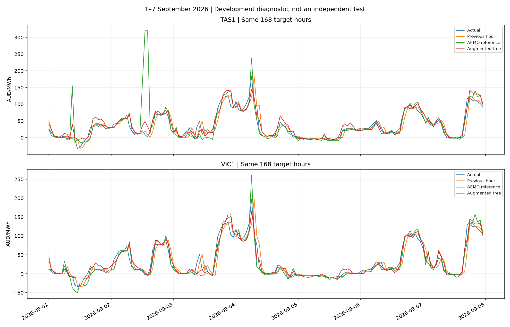

# NEM Pulse — Electricity Price Analytics & Procurement Risk

An evolving portfolio project for energy retailers, using Australian National Electricity Market (NEM) data to explore wholesale electricity prices, next-hour forecasts and procurement exposure.

[Historical dashboard](https://yangyinggit123.github.io/nem-pulse-energy-analytics/prototype/) · [Forecast experiments](https://yangyinggit123.github.io/nem-pulse-energy-analytics/prototype/forecast.html?v=aemo3)

Both pages support English and Chinese. The site presents historical observations and saved backtest results. It is not a live forecasting service, and no real customer portfolio or trading system is connected.

## Progress and roadmap

| Stage | Status | Scope |
|---|---|---|
| V0.2 — Historical analysis | Completed | CSV validation, descriptive statistics, daily and intraday charts |
| V0.3 — SQL and visualisation | SQL and web dashboard completed; Power BI pending | Twelve months of TAS1/VIC1 data, SQLite, monthly/hourly summaries and interactive filters |
| V0.4 — Forecasting | In development | Persistence baselines, Ridge, gradient boosting, an initial prediction-interval experiment and AEMO predispatch features |
| V0.5 — Procurement-risk alerts | Planned | Simulated retailer customer loads, unhedged exposure, high-price alerts and cost scenarios |
| V1.0 — Automated reporting | Planned | Data refresh, quality checks, charts and market reports |

## Historical data

Coverage: **November 2025–October 2026**, Tasmania (TAS1) and Victoria (VIC1): **210,240 five-minute records**, 105,120 per region.

The 24 monthly files were downloaded from [AEMO aggregated data](https://www.aemo.com.au/energy-systems/electricity/national-electricity-market-nem/data-nem/aggregated-data). Download URLs and hashes are recorded in `data/download_manifest.csv`; checks are in `data/quality_report.json`.

- Prices: AUD/MWh; regional demand: MW.
- Time: NEM AEST (UTC+10), without daylight saving.
- Five-minute timestamps mark interval endings. Subtract five minutes before assigning the interval to its month, day or hour.
- Negative prices and spikes are retained.
- RRP > 300 AUD/MWh is an illustrative high-price threshold, not an official risk standard.
- Regional demand is not a retailer's customer portfolio load.

Official data can be revised. The historical downloader checks hashes rather than silently accepting changed files. AEMO data remains subject to its applicable terms; this repository does not grant a separate data licence.

## Local database and public website

The SQLite database is stored locally at `data/nem_pulse.db`. The website reads published CSV results and images; it does not connect to the local database.

| Table | Grain | Rows in the current local dataset |
|---|---|---:|
| `price_demand` | Region + five-minute interval ending | 210,240 |
| `monthly_summary` | Region + month | 24 |
| `hourly_risk_summary` | Region + hour of day across the year | 48 |
| `predispatch_region_forecast` | Region + forecast vintage + target interval | Multiple versions retained |
| `predispatch_hourly_features` | Region + hourly forecast origin, August–September 2026 | 2,928 |

Summary tables are derived snapshots, not foreign-key-linked dimensions. Refresh them when inputs change. The database, virtual environment and large raw forecast archives are kept locally. Publishing a database file to GitHub would provide a download, not an online database service.

## AEMO predispatch expansion

The local expansion covers **1 August–30 September 2026 (61 days)**:

- 1,464 hourly origins per region, 2,928 hourly feature rows in total.
- 5,856 selected half-hour forecast-version rows, drawn from ten weekly archives including the lead-in period.
- Inputs include predispatch price, regional demand, available generation/load, net interchange, and semi-scheduled wind/solar forecasts.

Source: [AEMO predispatch reports](https://www.aemo.com.au/energy-systems/electricity/national-electricity-market-nem/data-nem/market-management-system-mms-data/pre-dispatch).

For each hourly origin, we select a report generated no later than that origin and covering the next two half-hour periods. Their forecast prices are averaged to construct an hourly reference; this is our aggregation, not a separately published AEMO hourly forecast.

**Availability limitation:** report generation time is a proxy. Actual publication/delivery time has not been verified. The target-hour actual price is used only as a label, never as a predictor. Prior-hour actual observations are assumed available at the forecast origin.

## Latest forecast comparison

Target: the next hour's average wholesale price, evaluated as rolling one-hour forecasts.

For a controlled comparison, both tree models use **August 2026 for training (744 hours per region)** and **September for development evaluation (720 hours per region)**, with the same fixed model parameters.

| Method | TAS1 MAE | VIC1 MAE |
|---|---:|---:|
| Previous-hour persistence | 11.75 | 11.36 |
| AEMO predispatch reference | 12.65 | **9.82** |
| History-only gradient boosting | 11.60 | 12.44 |
| Gradient boosting with AEMO features | **11.19** | 10.19 |

MAE is measured in AUD/MWh; lower is better. Added features reduced MAE relative to the same-period history-only tree by approximately **3.5% in TAS1** and **18.1% in VIC1**. AEMO's reference still had the lowest VIC1 MAE.

September has already been used for development, and October has also been evaluated separately. Neither is now an untouched independent test. These results do not establish future performance, causal effects, or procurement savings.



[Hourly predictions](data/processed/augmented_forecast_development_predictions.csv) · [Full metrics](data/processed/augmented_forecast_development_metrics.csv) · [Experiment protocol](reports/augmented_forecast_protocol.json) · [Comparison script](scripts/compare_augmented_forecasts.py)

### Earlier experiments

The earlier VIC1 experiment trained on November 2025–August 2026 (7,272 usable hours) and evaluated September (720 hours):

| Method | September MAE (AUD/MWh) |
|---|---:|
| Previous-hour persistence | 11.36 |
| Previous-day same-hour persistence | 40.58 |
| Ridge | 17.33 |
| Gradient boosting | 9.88 |

The latest history-only tree was retrained on August alone to match the shorter predispatch dataset. Its result is not the same model as the earlier 9.88 result.

A separate October evaluation produced MAE of approximately 13.88 for persistence and 13.65 for the longer-history tree. An initial fixed-width prediction-interval experiment was also completed locally. These later local experiments are not all reproduced in the public website or repository yet.

## Repository structure

```text
data/
  raw/                    # Original October inputs; additional inputs downloaded locally
  processed/              # Historical summaries and saved forecast results
  download_manifest.csv
  quality_report.json
prototype/
  index.html              # Historical dashboard
  forecast.html           # Forecast experiments
  forecast.js
  forecast-expanded.js    # Latest bilingual comparison
scripts/                  # Data processing, database import and model experiments
sql/                      # Summary queries
reports/
  figures/
  augmented_forecast_protocol.json
README.md
requirements.txt
```

## Run the historical workflow locally

Use Python 3.10 or later. From the repository root on macOS/Linux:

```bash
python3 -m venv .venv
source .venv/bin/activate
python -m pip install -r requirements.txt
python scripts/download_data.py
python scripts/create_database.py
python scripts/import_data.py
sqlite3 data/nem_pulse.db < sql/create_summary_tables.sql
python scripts/prepare_hourly.py
python scripts/baseline_forecast.py
python scripts/train_price_model.py
python scripts/train_nonlinear_model.py
python scripts/plot_forecast.py
```

The summary-table creation script is intended for initial setup; review the refresh process before rerunning it against existing tables. Repeated raw imports update region/time keys instead of duplicating rows, but do not automatically remove stale records. The original `scripts/process_data.py` remains an October-only workflow.

For the latest predispatch experiment, the comparison script requires the populated local `predispatch_hourly_features` table. `scripts/prepare_predispatch_features.py` additionally requires the ten local weekly archives and an existing `predispatch_region_forecast` table. The full archive-download/schema setup is not yet packaged as a clean-clone workflow; published prediction CSVs can be inspected without it.

## Procurement-risk scope

The intended user is an energy retailer assessing wholesale purchase exposure. V0.5 will combine price scenarios with a simulated customer portfolio and explicit hedge assumptions.

Earlier constant **10 MW**, fully spot-exposed examples are simulations, not observed retailer costs or losses. Real procurement analysis also needs customer interval loads, contract/hedge terms, losses and applicable charges. Hourly average prices can conceal five-minute spikes. A lower average forecast error alone does not demonstrate an effective risk alert or profitable procurement decision.
