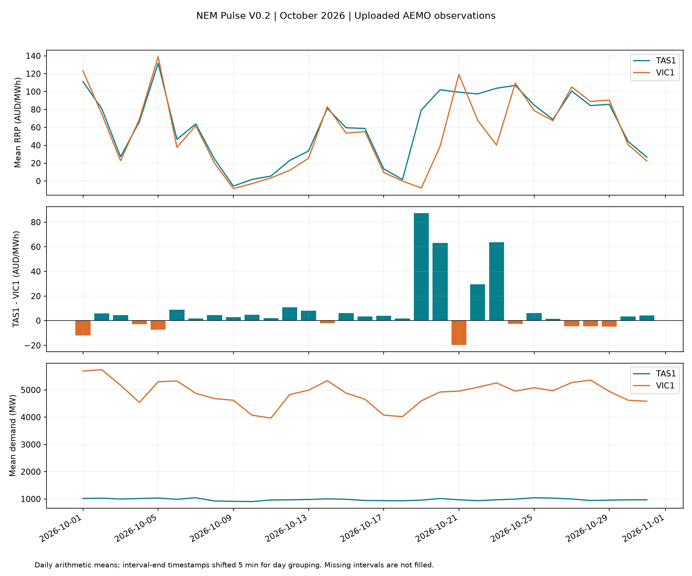

# NEM Pulse V0.2 — Tasmania vs Victoria

A beginner-friendly Python workflow for comparing wholesale electricity prices and regional demand in Tasmania (TAS1) and Victoria (VIC1), using uploaded AEMO CSV files for October 2026.

**Website status:** The existing `prototype/index.html` still uses simulated data. This release adds an offline analysis workflow; it does not connect the website to real data. The existing website is not included in this package.

## October 2026 results

| Metric | TAS1 | VIC1 |
|---|---:|---:|
| Mean wholesale price (AUD/MWh) | 61.59 | 52.94 |
| Median wholesale price (AUD/MWh) | 88.14 | 55.52 |
| Negative-price intervals | 18.66% | 26.97% |
| Mean regional demand (MW) | 978.07 | 4,885.05 |
| Peak interval demand (MW) | 1,281.83 | 7,367.24 |

The mean simultaneous price spread (TAS1 minus VIC1) was **+8.65 AUD/MWh**. TAS1 was more expensive in **57.35%** of intervals. These are descriptive observations, not evidence of what caused the price differences. Wholesale prices do not represent household electricity bills.



## Project structure

Copy the package contents into your existing `nem-pulse-energy-analytics` repository. Preserve the existing `prototype/` directory. If the repository already has a README, merge the relevant sections before replacing it.

```text
nem-pulse-energy-analytics/
├── README.md
├── requirements.txt
├── .gitignore
├── scripts/
│   └── process_data.py
├── data/
│   ├── raw/
│   │   ├── PRICE_AND_DEMAND_202610_TAS1.csv
│   │   └── PRICE_AND_DEMAND_202610_VIC1.csv
│   └── processed/
│       ├── price_demand_clean.csv
│       ├── tas_vic_aligned.csv
│       ├── daily_summary.csv
│       ├── monthly_summary.csv
│       └── quality_report.json
├── reports/
│   ├── analysis_zh.md
│   └── figures/tas_vs_vic_oct2026.png
└── prototype/
    └── index.html  # Existing simulated-data website; not included here
```

`analysis_zh.md` contains the detailed analysis in Chinese. This README provides an English project overview and setup guide.

## Step 1: Set up Python

Install Python 3.10 or later. Open the project folder in VS Code, then open a terminal. Run the commands from the folder containing this README.

### macOS / Linux

```bash
python3 -m venv .venv
source .venv/bin/activate
python -m pip install -r requirements.txt
```

### Windows PowerShell

```powershell
py -m venv .venv
.venv\Scripts\Activate.ps1
python -m pip install -r requirements.txt
```

If PowerShell blocks activation, use the environment's Python directly:

```powershell
.venv\Scripts\python.exe -m pip install -r requirements.txt
.venv\Scripts\python.exe scripts/process_data.py
```

## Step 2: Run the analysis

With the virtual environment activated:

```bash
python scripts/process_data.py
```

The script prints summary statistics and creates or overwrites derived files in `data/processed/` and `reports/figures/`. It preserves the original CSV files. Open the PNG to view the results; running the website is not required.

## Input data and actual columns

The input files are the two user-uploaded AEMO CSV attachments, preserved in `data/raw/`. They were not downloaded again or compared row by row with the latest online versions.

Source: [AEMO Aggregated price and demand data](https://aemo.com.au/energy-systems/electricity/national-electricity-market-nem/data-nem/aggregated-data).

| Column | Meaning and handling |
|---|---|
| `REGION` | TAS1 or VIC1; checked against the expected file region |
| `SETTLEMENTDATE` | Interval-ending timestamp; strictly parsed and sorted |
| `TOTALDEMAND` | Regional demand in MW; not household consumption or energy in MWh |
| `RRP` | Regional Reference Price in AUD/MWh; negative prices are retained |
| `PERIODTYPE` | All supplied records are TRADE; other values trigger an error for review |

Each file contains **8,928 records**, covering interval endings from **2026-10-01 00:05** through **2026-11-01 00:00**, inclusive. Both files have complete five-minute coverage, with no missing values or duplicate timestamp keys, and align exactly.

Input SHA-256 hashes are stored in `quality_report.json` for reproducibility.

## Processing and calculation methods

- Validate column names, numeric values, region identifiers, period types and timestamp keys.
- Preserve negative prices and extreme values. Do not fill missing intervals with zero or interpolate them.
- Save a cleaned long-format table, then join the two regions by timestamp using an outer join.
- Define the price spread consistently as **TAS1 RRP − VIC1 RRP**.
- Calculate mean prices using equal weight for each available five-minute interval.
- Calculate demand-weighted price separately as `sum(RRP × TOTALDEMAND) / sum(TOTALDEMAND)`. This is a descriptive measure, not a household tariff or contracted purchasing cost.
- Group daily results using the interval-ending timestamp minus five minutes, so an interval ending at midnight belongs to the preceding day. A complete day contains 288 intervals; `tas_n` and `vic_n` report the observed counts.

Timestamps retain the source clock and are interpreted as NEM market time: AEST (UTC+10), without daylight saving adjustments. They are not converted to the computer's local timezone. See [AEMO's NEM time explanation](https://www.aemo.com.au/Electricity/National-Electricity-Market-NEM/~/-/media/F1314EB879E544708E29A5C04CF0111E.ashx).

The script stops on invalid formats, duplicate keys, unexpected regions or period types, and timestamps outside the expected month. Missing intervals are recorded in the quality report. If inputs are incomplete, averages describe available observations and must not be presented as complete-month results.

**To analyze another month, update both the input filenames and the `expected` date range in the script.**

## Output files

| File | Purpose |
|---|---|
| `price_demand_clean.csv` | Cleaned records for both regions in long format |
| `tas_vic_aligned.csv` | One row per timestamp, with both regions and their price spread |
| `daily_summary.csv` | Daily mean prices, spread and demand, plus interval counts |
| `monthly_summary.csv` | Monthly price and demand statistics for each region |
| `quality_report.json` | Coverage checks, alignment counts, input hashes and spread statistics |
| `tas_vs_vic_oct2026.png` | Daily price, spread and demand comparison |

The chart shows daily averages, which conceal five-minute price spikes. Use the interval-level CSV files to inspect extremes.

## Limitations

Price and demand alone cannot establish whether price differences were caused by generation mix, hydrology, interconnector constraints, outages, weather or bidding behaviour. Further analysis requires additional data and a suitable research design. Correlation is not causation.

A single month's results should not be generalized to annual prices, future prices or household electricity bills. Regional demand levels also reflect differences in regional scale; they do not establish per-person consumption or efficiency.

Running the script regenerates the CSV files and chart, but does not update written statistics in this README or `reports/analysis_zh.md`. Recheck the written results whenever inputs change. The verified runtime versions are recorded in that report.

## Next steps

1. Add the offline analysis files and chart to the existing GitHub repository.
2. Keep the website clearly labelled as using simulated data.
3. Connect the website to processed data in a future release, displaying the source, month, units and update date.
4. Check that website values match the processed CSV files before describing the website as using real data.
